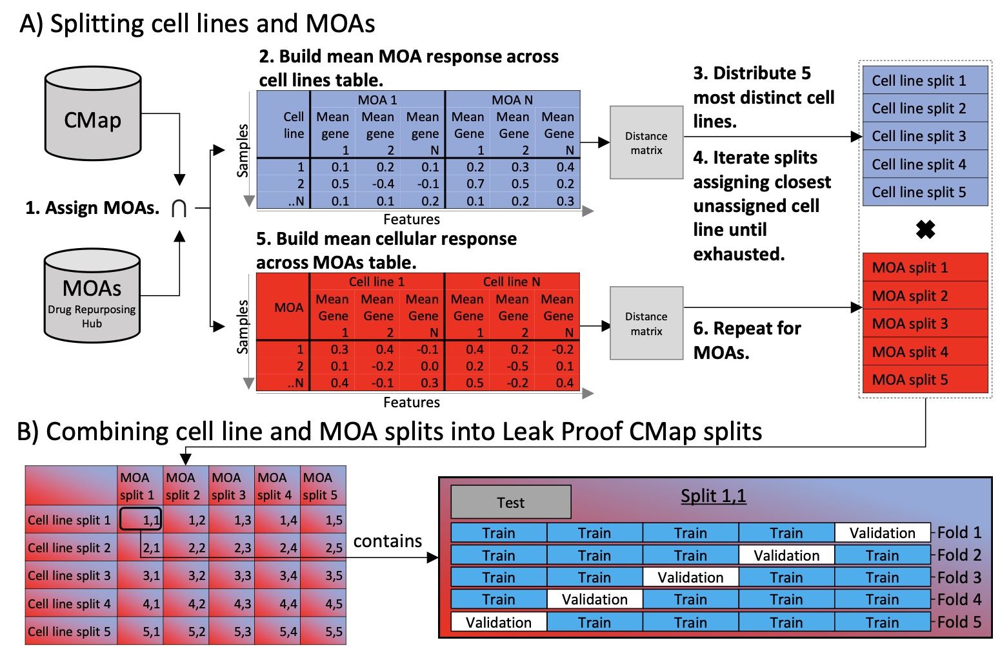

<!--more-->

  <a href="https://arxiv.org/abs/2404.18960" class="btn btn--primary" style="padding: 0.8em 1.6em; font-size: 1.1em; text-decoration: none; border-radius: 6px; background-color: #2c3e50; color: white; transition: all 0.3s ease; box-shadow: 0 2px 5px rgba(0,0,0,0.1); &:hover { background-color: #34495e; transform: translateY(-2px); box-shadow: 0 4px 8px rgba(0,0,0,0.2); }">Read Paper</a>

#### :dart: Project Overview
**Leak Proof CMap** is a framework for the **training and evaluation of phenotypic similarity methods** using the Connectivity Map (CMap) L1000 transcriptomic dataset.  
It establishes the most rigorous **leak-proof data splitting regime** reported to date, ensuring unbiased benchmarking and fair comparison of similarity methods across **novel cell lines** and **novel mechanisms of action (MOAs)**.

#### :gear: Technical Implementation

  
*Leak Proof CMap split strategy: independent cell line and MOA splits combined into 25 leak-proof benchmark sets.*

#### :rocket: Key Features

1. **Leak-Proof Data Splits**  
   - Five diverse *cell line* splits and five *MOA* splits combined into 25 benchmark sets.  
   - Prevents information leakage between train/validation/test, mimicking deployment on unseen treatments.

2. **Benchmarking Tasks**  
   - **Compactness** → percent replicating metric (how tightly replicates cluster).  
   - **Distinctness** → permutation testing vs DMSO (hit calling).  
   - **Uniqueness** → AUROC (retrieval of correct replicates across large datasets).

3. **Method Evaluation**  
   - Classical metrics: Spearman Rank, Zhang, cosine, Euclidean, Euclidean-PCA.  
   - AI/ML method: **Triplet-loss neural network** embedding into 128D latent space.  
   - Triplet-loss significantly outperformed others in *compactness* and *uniqueness*, setting a new benchmark for similarity-based MOA discovery.

4. **Open-Source Tooling**  
   - Python package: [`leakproofcmap`](https://github.com/GSK-AI/leak-proof-cmap)  
   - Includes dataset preparation, splitting routines, and benchmarking pipelines.

#### :microscope: Case Studies

1. **Novel Cell Line Generalization**  
   - Models evaluated on entirely unseen cell lines.  
   - Triplet-loss embeddings remained robust, showing potential for **patient-derived samples**.

2. **Unbiased MOA Prediction**  
   - Evaluation with 433 MOAs and 1,309 compounds across 30 cell lines (~177k profiles).  
   - Demonstrated reliable recovery of mechanisms even under strict leak-proof regimes.

3. **Hit Calling in Drug Discovery**  
   - Distinctness benchmark highlighted Euclidean-PCA as the most effective metric for hit vs control separation.  
   - Supports early-stage high-throughput screening campaigns.

#### :books: Documentation & Resources

- [GitHub Repository](https://github.com/GSK-AI/leak-proof-cmap)  
- [Preprint on arXiv](https://arxiv.org/abs/2404.18960)

  <a href="https://arxiv.org/abs/2404.18960" class="btn btn--primary" style="padding: 0.8em 1.6em; font-size: 1.1em; text-decoration: none; border-radius: 6px; background-color: #2c3e50; color: white; transition: all 0.3s ease; box-shadow: 0 2px 5px rgba(0,0,0,0.1); &:hover { background-color: #34495e; transform: translateY(-2px); box-shadow: 0 4px 8px rgba(0,0,0,0.2); }">Read Paper</a>

